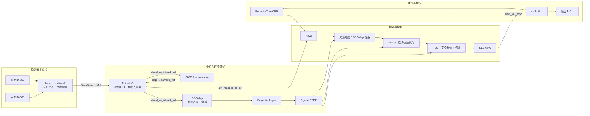
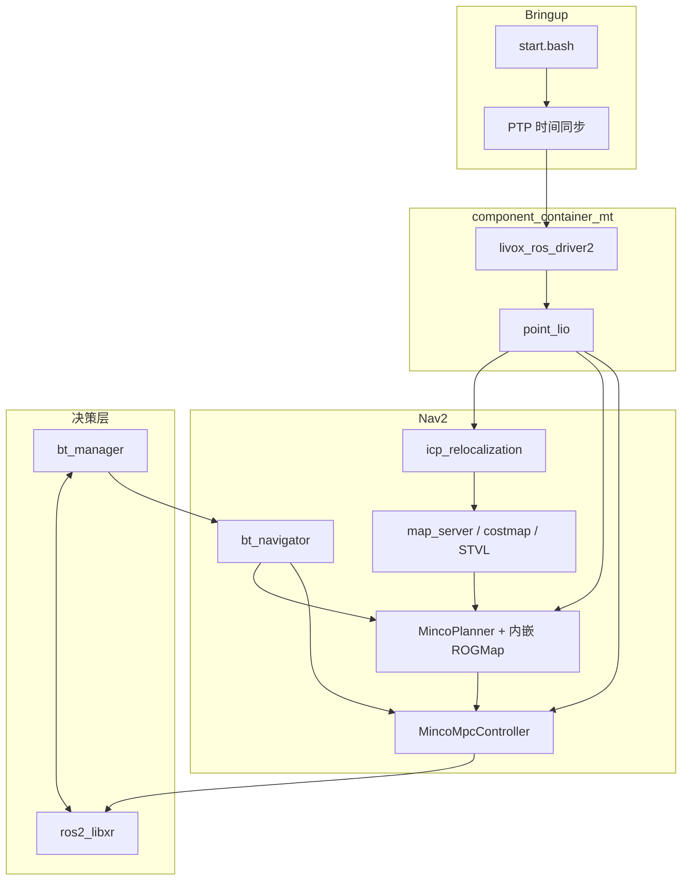

<div align="center">

# PLDX RoboMaster Sentry Navigation

**面向 RoboMaster 哨兵的 ROS 2 感知 · 规划 · 控制 · 决策系统**

[](https://docs.ros.org/en/jazzy/)
[](https://releases.ubuntu.com/24.04/)
[](LICENSE)
[](https://www.robomaster.com/)
[](https://isocpp.org/)
[](src/navigation/minco_planner)
[](src/navigation/minco_controller)

</div>

## 📌 项目简介

本项目面向 RoboMaster 复杂地形、动态对抗和高速全向运动场景，在 ROS 2 Jazzy 上构建从激光雷达输入到比赛决策的完整自主导航闭环：

```text
双 Livox MID-360 → Point-LIO → GICP 重定位 → ROGMap → 全局搜索 / MINCO → SE(2) MPC → 底盘
                                          ↑                              ↑
                                   Nav2 + 先验地图                 行为树 + 裁判系统
```

系统以 Point-LIO 高频里程计和稠密去畸变点云为感知基础，通过 GICP 完成 `map → camera_init` 重定位，由 ROGMap 维护滑动三维概率占据地图、地形语义投影和 Signed ESDF。规划端提供 `PRIORMAP` 与 `EXPLORATION` 双模式，将离散路径连续化为满足运动约束的 MINCO 轨迹；控制端使用速度层 SE(2) MPC 跟踪轨迹。比赛策略由 BehaviorTree.CPP 管理，通信节点连接裁判系统和底盘。


| 项目     | 当前配置                                      |
| -------- | --------------------------------------------- |
| 操作系统 | Ubuntu 24.04                                  |
| ROS      | ROS 2 Jazzy                                   |
| 计算平台 | Intel NUC 13，Core i5-1340P，32 GB RAM        |
| 激光雷达 | 2 × Livox MID-360，驱动侧融合                |
| 底盘     | 全向底盘；控制器输出世界坐标系速度            |
| ROGMap   | `0.05 m` 分辨率，`10 × 10 × 1.5 m` 滑动窗口 |
| 规划     | `PRIORMAP`，20 Hz MINCO 优化                  |
| 控制     | 100 Hz Nav2 controller server，MPC 时域 0.5 s |

## 📑 目录

- [项目简介](#-项目简介)
- [亮点](#-亮点)
- [功能模块](#-功能模块)
- [依赖](#-依赖)
- [Quick Start](#-quick-start)
- [启动节点](#-启动节点)
- [话题与服务](#-话题与服务)
- [配置文件](#️-配置文件)
- [数据流图](#-数据流图)
- [软件架构](#-软件架构)
- [文件结构](#-文件结构)
- [致谢](#-致谢)

## ✨ 亮点

- **双雷达驱动侧融合**：`livox_ros_driver2` 按雷达 IP 区分前后雷达，将后雷达点变换到前雷达坐标系并做时间窗口融合；与 Point-LIO 同进程 intra-process 传输。
- **稠密去畸变 LIO**：Point-LIO 输出按时间处理、去畸变并变换到 `camera_init` 的 `/cloud_registered_full`；`blind_center` 将近场裁剪中心移到车体关注点。
- **GICP 重定位**：离线加载地图 PCD，在线累积点云后做粗/精两阶段 GICP，确认后持续发布 `map → camera_init` TF。
- **ROGMap + Signed ESDF**：滑动三维概率占据、动态遗忘、地形语义投影，以及障碍外正距离 / 障碍内负距离的连续梯度场。
- **MINCO 双模式规划**：`PRIORMAP` 利用 Nav2 先验地图全局引导；`EXPLORATION` 直接在 ROGMap 有效边界内搜索。
- **SE(2) MPC**：状态 `[x, y, yaw]`，控制 `[vx, vy, omega]`，qpOASES 求解凝聚 QP，输出世界系速度。
- **比赛行为树**：BehaviorTree.CPP XML 定义战术、导航、姿态、资源、云台和恢复策略。
- **裁判 / 底盘通信**：默认使用 `ros2_libxr` 桥接，按工程协议契约适配 XR topic 与 payload。

## 🧩 功能模块


| 模块                               | 描述                                     | 关键技术                                        |
| ---------------------------------- | ---------------------------------------- | ----------------------------------------------- |
| `livox_ros_driver2`                | 双 MID-360 驱动、时间对齐与外参融合      | 时间窗配对、`back → front` 外参、intra-process |
| `point_lio`                        | 高频 LIO、稠密去畸变点云                 | ESIKF、iVox KNN、分段运动补偿                   |
| `icp_relocalization`               | 地图 PCD 与在线点云 GICP 重定位          | small_gicp、多初值、一致性确认                  |
| `rog_map`                          | 三维概率占据、地形投影、Signed ESDF      | dirty-column、进程内`MapQueryInterface`         |
| `minco_planner`                    | Nav2 全局规划插件：搜索 + MINCO 轨迹优化 | A\*/SMAC、MINCO、FSM、ESDF 恢复                 |
| `minco_controller`                 | Nav2 控制器插件：SE(2) MPC 跟踪          | qpOASES、延迟/杆臂补偿                          |
| `navi2`                            | Nav2 bringup、先验地图、参数与 RViz      | Navigation2、STVL                               |
| `bt_manager`                       | 比赛决策中枢                             | BehaviorTree.CPP v3、共享 blackboard            |
| `ros2_libxr`                       | 裁判系统 / 底盘通信桥                    | LibXR、SharedTopic                              |
| `communication`                    | 旧版通信节点（默认不启动）               | 自定义协议                                      |
| `dbscan_cluster`                   | 实验性点云聚类（默认未启用）             | DBSCAN、Kalman 跟踪                             |
| `pcd2pgm` / `pcd2esdf` / `pcd2ele` | 地图工具                                 | PCD → PGM / ESDF / 高程                        |

更深入的模块文档：

- [MincoPlanner](src/navigation/minco_planner/README.md)
- [MincoMpcController](src/navigation/minco_controller/README.md)
- [Communication](src/navigation/communication/README.md)
- [bt_manager](src/decision/bt_manager/README.md)
- [Point-LIO](src/perception/Point-LIO/README.md)
- [ROGMap](src/perception/rog_map/README.md)
- [Livox ROS Driver 2](src/perception/livox_ros_driver2/README.md)
- [icp_relocalization](src/perception/icp_relocalization/README.md)
- [Simulation](src/simulation/README.md)

## 📦 依赖

### 系统与 ROS

- Ubuntu 24.04
- ROS 2 Jazzy Desktop
- GCC / G++ 与 C++17
- Livox-SDK2
- Nav2、STVL、BehaviorTree.CPP v3、PCL、Eigen3、OpenMP、yaml-cpp、glog、fmt
- 可选：OpenCV（地图工具）

```bash
export ROS_DISTRO="${ROS_DISTRO:-jazzy}"
source "/opt/ros/${ROS_DISTRO}/setup.bash"
sudo apt update
sudo apt install -y \
  python3-colcon-common-extensions python3-rosdep \
  libeigen3-dev libpcl-dev libyaml-cpp-dev libgoogle-glog-dev \
  libunwind-dev libfmt-dev libopencv-dev libomp-dev \
  ros-${ROS_DISTRO}-backward-ros \
  ros-${ROS_DISTRO}-pcl-ros \
  ros-${ROS_DISTRO}-pcl-conversions \
  ros-${ROS_DISTRO}-ament-cmake \
  ros-${ROS_DISTRO}-behaviortree-cpp-v3 \
  ros-${ROS_DISTRO}-spatio-temporal-voxel-layer

mapfile -t ros_nav_packages < <(
  apt-cache pkgnames \
    | grep -E "^ros-${ROS_DISTRO}-(nav|nav2)" \
    | grep -v -- '-dbgsym$'
)
sudo apt install -y "${ros_nav_packages[@]}"

sudo rosdep init   # 仅首次
rosdep update
rosdep install --from-paths src --ignore-src -r -y
```

> [!NOTE]
> 仓库已包含 qpOASES third-party 回退实现。部分包的 `package.xml` 仍未覆盖所有系统依赖，`rosdep` 之后可能仍需按报错安装系统库。

### 源码依赖


| 依赖                                                                         | 说明                                                |
| ---------------------------------------------------------------------------- | --------------------------------------------------- |
| [Livox-SDK2](https://github.com/Livox-SDK/Livox-SDK2)                        | 雷达驱动底层 SDK，需安装到系统路径                  |
| [small_gicp](https://github.com/koide3/small_gicp#installation)              | GICP 重定位，安装 C++ 版本                          |
| [Sophus](https://github.com/strasdat/Sophus#how-to-build-sophus-from-source) | 李群库，安装 C++ 版本                               |
| `pldx_vision_interfaces`                                                     | 视觉 overlay，`bt_manager` 消费 `TargetObservation` |
| `src/navigation/ros2_libxr`                                                  | 内置的 QDU-VRobot ROS2_LIBXR 源码                  |

Livox-SDK2 典型安装：

```bash
git clone https://github.com/Livox-SDK/Livox-SDK2.git
cd Livox-SDK2
mkdir build && cd build
cmake ..
make -j"$(nproc)"
sudo make install
```

## ⚡ Quick Start

```bash
# 1. 克隆仓库
git clone https://github.com/Wanqiq7/Pldx_ws.git navi_minco_bit_jazzy
cd navi_minco_bit_jazzy
git checkout master

# 2. 指定视觉 overlay（提供 pldx_vision_interfaces）
export ROS_DISTRO="${ROS_DISTRO:-jazzy}"
source "/opt/ros/${ROS_DISTRO}/setup.bash"
export PLDX_VISION_WS="/path/to/vision_ws"

# 3. 构建
./build.bash
source install/setup.bash
```

`build.bash` 会在 `MEM_LIMIT_GB` 内先串行构建高内存关键包，再并行构建其余包：

```bash
MEM_LIMIT_GB=24 MEM_PER_WORKER_GB=2 ./build.bash
```

`bt_manager` 直接消费 `vision/target_observation`（`pldx_vision_interfaces/msg/TargetObservation`）。视觉 overlay 在构建和运行时都需要，部署时还需提供带时间戳的 `map ← vision_gimbal` TF。MCU 通信必须保持 `/sentry/offline_info` 的单一发布者。

> [!WARNING]
> `start.bash` 会打开多个 GNOME Terminal、启动 PTP sudo 命令，并可能向底盘发送控制数据。更适合实车桌面环境，不适合无界面服务器。上车前应架空轮组或保证机械急停可用。

## 🚀 启动节点

每个终端先执行：

```bash
cd /path/to/navi_minco_bit_jazzy
export ROS_DISTRO="${ROS_DISTRO:-jazzy}"
source "/opt/ros/${ROS_DISTRO}/setup.bash"
source install/setup.bash
```


| 文件 / 入口                                     | 功能                         | 命令                                                                  |
| ----------------------------------------------- | ---------------------------- | --------------------------------------------------------------------- |
| `mixed_livox_pointlio_intra_process.launch.py`  | 双雷达 + Point-LIO（同进程） | `ros2 launch point_lio mixed_livox_pointlio_intra_process.launch.py`  |
| `single_livox_pointlio_intra_process.launch.py` | 单雷达 + Point-LIO           | `ros2 launch point_lio single_livox_pointlio_intra_process.launch.py` |
| `msg_mixed_MID360.launch.py`                    | 仅启动双雷达驱动             | `ros2 launch livox_ros_driver2 msg_mixed_MID360.launch.py`            |
| `gicp_relocalization.launch.py`                 | GICP 重定位                  | `ros2 launch icp_relocalization gicp_relocalization.launch.py`        |
| `navigation2.launch.py`                         | Nav2 + ROGMap + MINCO + MPC  | `ros2 launch navi2 navigation2.launch.py`                             |
| `bt_manager.launch.py`                          | 比赛决策                     | `ros2 launch bt_manager bt_manager.launch.py`                         |
| `ros2_libxr_node`                               | 裁判 / 底盘通信              | `ros2 run ros2_libxr ros2_libxr_node`                                 |
| `start.bash`                                    | 实车一键启动                 | `bash start.bash`                                                     |
| `simulation.launch.py`                          | Gazebo 仿真                  | `ros2 launch rmu_gazebo_simulator simulation.launch.py`               |

### 分模块启动（推荐首次上车）

```bash
ros2 launch point_lio mixed_livox_pointlio_intra_process.launch.py
ros2 launch icp_relocalization gicp_relocalization.launch.py
ros2 launch navi2 navigation2.launch.py
ros2 launch bt_manager bt_manager.launch.py
```

当前 MINCO 输出为 `/cmd_vel_mpc`。启用 `ros2_libxr` 时，通信节点直接订阅该话题并发送到底盘；如需修改输入话题，需要同步修改 `ros2_libxr` 节点源码和相关配置。

### 一键实车启动

```bash
bash start.bash
```

脚本依次启动：

1. `ros2_libxr` 通信节点（`ROS2_LIBXR_ENABLE=0` 时跳过）
2. PTP 时间同步
3. 双雷达 + Point-LIO component container
4. GICP 重定位
5. Nav2 + ROGMap + MincoPlanner + MincoMpcController
6. bt_manager

`start.bash` 默认启用 XR 桥（`ROS2_LIBXR_ENABLE=1`），不启动旧 `communication` 包。如需使用另一个已安装且兼容的 ROS2_LIBXR 工作区，可设置 `ROS2_LIBXR_WS`。

### 先验地图

```bash
ros2 launch navi2 navigation2.launch.py map:=/absolute/path/to/map.yaml
```

默认地图为 `src/navigation/navi2_bringup/maps/2026/rmuc2026.yaml`。无先验地图时将 `MincoPlanner.planner_mode` 改为 `EXPLORATION`。

### 仿真

```bash
ros2 launch rmu_gazebo_simulator simulation.launch.py
# 无 GUI：
ros2 launch rmu_gazebo_simulator simulation.launch.py use_rviz:=false headless:=true
```

详见 [src/simulation/README.md](src/simulation/README.md)。

## 📡 话题与服务

### 感知与定位


| 话题                     | 类型                              | 方向 | 说明                              |
| ------------------------ | --------------------------------- | ---- | --------------------------------- |
| `/livox/lidar`           | `livox_ros_driver2/msg/CustomMsg` | 发布 | 双雷达融合后的点云                |
| `/livox/imu_<ip>`        | `sensor_msgs/msg/Imu`             | 发布 | 主雷达 IMU（当前`192.168.1.135`） |
| `/aft_mapped_to_init`    | `nav_msgs/msg/Odometry`           | 发布 | Point-LIO 位姿、体轴速度          |
| `/cloud_registered_full` | `sensor_msgs/msg/PointCloud2`     | 发布 | 世界系稠密去畸变点云              |
| `/cloud_registered`      | `sensor_msgs/msg/PointCloud2`     | 发布 | 常规配准点云（Nav2 STVL）         |
| `/Laser_map`             | `sensor_msgs/msg/PointCloud2`     | 发布 | 低频累计地图                      |

### 规划与控制


| 话题                        | 类型                                    | 方向 | 说明                          |
| --------------------------- | --------------------------------------- | ---- | ----------------------------- |
| `/opt_path`                 | `ros_interfaces/msg/MpcPositionCommand` | 发布 | MINCO 优化轨迹（P/V/A/J/Yaw） |
| `/cmd_vel_mpc`              | `geometry_msgs/msg/Twist`               | 发布 | MPC 世界系速度                |
| `/opt_path_vis`             | `nav_msgs/msg/Path`                     | 发布 | 优化轨迹可视化                |
| `/astar_path_vis`           | `nav_msgs/msg/Path`                     | 发布 | 搜索路径可视化                |
| `/minco_control_points_vis` | `visualization_msgs/msg/Marker`         | 发布 | MINCO 控制点                  |
| `/mpc_predict_path`         | `nav_msgs/msg/Path`                     | 发布 | MPC 预测轨迹                  |
| `/recover_goal`             | `visualization_msgs/msg/Marker`         | 发布 | ESDF 恢复目标                 |

### ROGMap


| 话题                          | 类型                          | 说明               |
| ----------------------------- | ----------------------------- | ------------------ |
| `/rog_map/occupied`           | `sensor_msgs/msg/PointCloud2` | 三维占据体素       |
| `/rog_map/layer_value`        | `nav_msgs/msg/OccupancyGrid`  | 二维语义代价值     |
| `/rog_map/layer_type`         | `nav_msgs/msg/OccupancyGrid`  | 地形类型           |
| `/rog_map/layer_height_delta` | `sensor_msgs/msg/PointCloud2` | 单柱占据高度跨度   |
| `/rog_map/field`              | `sensor_msgs/msg/PointCloud2` | Signed ESDF 可视化 |

规划端通过进程内 `MapQueryInterface` 查询占据 / 投影 / ESDF，不经过上述可视化话题。

### 决策与通信


| 话题                        | 类型                                               | 方向 | 说明            |
| --------------------------- | -------------------------------------------------- | ---- | --------------- |
| `/sentry/team_info`         | `ros_interfaces/msg/TeamInformation`               | 订阅 | 队伍信息        |
| `/sentry/game_info`         | `ros_interfaces/msg/GameInfo`                      | 订阅 | 比赛状态        |
| `/sentry/radar_info`        | `ros_interfaces/msg/RadarInfo`                     | 订阅 | 雷达站信息      |
| `/sentry/offline_info`      | `ros_interfaces/msg/SentryInfoOffline`             | 订阅 | 下位机离线状态  |
| `/sentry/online_info`       | `ros_interfaces/msg/SentryInfoOnline`              | 订阅 | 裁判在线状态    |
| `vision/target_observation` | `pldx_vision_interfaces/msg/TargetObservation`     | 订阅 | 视觉目标观测    |
| `/sentry/behaivor_send`     | `ros_interfaces/msg/Behavior`                      | 发布 | 行为 / 姿态指令 |
| `vision/target_directive`   | `pldx_vision_interfaces/msg/VisionTargetDirective` | 发布 | 视觉目标指令    |
| `/sentry/area_markers`      | `visualization_msgs/msg/MarkerArray`               | 发布 | 区域可视化      |

### Nav2 Action


| Action                    | 类型                                    | 说明           |
| ------------------------- | --------------------------------------- | -------------- |
| `/navigate_to_pose`       | `nav2_msgs/action/NavigateToPose`       | 导航到目标位姿 |
| `/navigate_through_poses` | `nav2_msgs/action/NavigateThroughPoses` | 途经点导航     |
| `/compute_path_to_pose`   | `nav2_msgs/action/ComputePathToPose`    | 仅规划         |
| `/follow_path`            | `nav2_msgs/action/FollowPath`           | 仅跟踪         |

建议观察频率：

```bash
ros2 topic hz /aft_mapped_to_init
ros2 topic hz /cloud_registered_full
ros2 topic hz /opt_path
ros2 topic hz /cmd_vel_mpc
```

## ⚙️ 配置文件


| 文件                                                                  | 作用                        |
| --------------------------------------------------------------------- | --------------------------- |
| `src/perception/livox_ros_driver2/config/mixed_MID360_config.json`    | 双雷达主机 IP / 雷达 IP     |
| `src/perception/livox_ros_driver2/config/mixed_MID360_component.yaml` | 融合开关、前后 IP、外参     |
| `src/perception/Point-LIO/config/mid360.yaml`                         | LIO 外参、盲区、发布        |
| `src/perception/icp_relocalization/config/gicp_relocalization.yaml`   | GICP 地图 PCD 与配准参数    |
| `src/navigation/navi2_bringup/params/sentry1.yaml`                    | Nav2 / MINCO / MPC / ROGMap |
| `src/navigation/navi2_bringup/maps/2026/`                             | 赛场先验地图                |
| `src/decision/bt_manager/tree/*.xml`                                  | 比赛行为树                  |
| `src/navigation/communication_protocol_contract.md`                   | 通信协议契约                |

以下四组配置存在耦合，建议按「网络 → 双雷达外参 → LIO/TF → 规划控制/ROGMap」的顺序标定。

### 1. Livox 主机 IP 与双雷达融合

当前双雷达基线：

```yaml
# mixed_MID360_config.json
host_net_info: 192.168.1.47       # NUC 有线网卡地址
lidar_configs:
  - 192.168.1.122                 # 后雷达
  - 192.168.1.135                 # 前雷达 / IMU 来源

# mixed_MID360_component.yaml
enable_internal_lidar_merge: true
merge_front_ip: 192.168.1.135
merge_back_ip: 192.168.1.122
merge_output_topic: livox/lidar
merge_max_interval_ms: 5.0
merge_extrinsic_back_to_front: [0.0, 0.38, -0.05, -0.36713, 0.0, 0.0]
```

`merge_extrinsic_back_to_front` 表示「后雷达坐标系 → 前雷达坐标系」的刚体外参。重新安装雷达后必须实测标定。Point-LIO 当前订阅 `livox/imu_192_168_1_135`；更换主雷达 IP 时需同步修改 launch 与 `mid360.yaml`。

### 2. Point-LIO 外参与坐标系

```yaml
preprocess:
  blind: 0.35
  blind_center_enable: true
  blind_center: [0.0, 0.20, 0.0]

mapping:
  extrinsic_est_en: false
  extrinsic_T: [-0.011, -0.02329, 0.04412]

publish:
  tf_send_en: true
```


| 输出                       | parent / child               | 说明                          |
| -------------------------- | ---------------------------- | ----------------------------- |
| `/aft_mapped_to_init`      | `camera_init` → `body`      | LIO odometry                  |
| `/cloud_registered[_full]` | `camera_init`                | 世界系配准点云                |
| TF                         | `camera_init` → `body`      | 完整 LIO 姿态                 |
| TF                         | `camera_init` → `base_link` | 平面姿态 +`[0, 0.20, 0]` 平移 |

> [!CAUTION]
> `camera_init → base_link` 的平移偏置当前硬编码在 `laserMapping.cpp`，不是 YAML 参数。不要额外启动同名静态 TF。

### 3. Planner / Controller 杆臂

`sentry1.yaml` 中 planner 与 controller 的 `lidar_offset_x/y` 必须同为 `[0.0, -0.20]`，参与 `v_body = v_lidar + ω × r`。原地旋转时，补偿后的底盘旋转中心平移速度应接近零。

### 4. ROGMap 滑窗与高度

```yaml
rog_map:
  frame_id: camera_init
  resolution: 0.05
  map_size: [10.0, 10.0, 1.5]
  map_sliding:
    center_offset_enable: true
    center_offset: [0.0, 0.20, 0.0]
  projection:
    scan_z_min_abs: -0.20
    scan_z_max_abs: 1.50
```

`scan_z_min_abs` / `scan_z_max_abs` 是 `camera_init` 中的绝对 Z，不是离地高度。`map_size.z` 必须覆盖扫描窗口。

### 配置一致性清单


| 物理量            | 配置位置                             | 当前值          |
| ----------------- | ------------------------------------ | --------------- |
| 前雷达 IP         | Livox JSON/YAML、Point-LIO IMU topic | `192.168.1.135` |
| 后雷达 IP         | Livox JSON/YAML                      | `192.168.1.122` |
| 近场关注中心      | `Point-LIO preprocess.blind_center`  | `[0, 0.20, 0]`  |
| LIO 到底盘中心 TF | `laserMapping.cpp offset_vec`        | `[0, 0.20, 0]`  |
| ROGMap 滑窗中心   | `rog_map.map_sliding.center_offset`  | `[0, 0.20, 0]`  |
| 速度杆臂          | planner/controller`lidar_offset_*`   | `[0, -0.20]`    |

### 关键运行参数（`sentry1.yaml` / `mid360.yaml` 基线）


| 模块               | 参数                                | 当前值                      |
| ------------------ | ----------------------------------- | --------------------------- |
| Point-LIO          | `preprocess.blind`                  | `0.35 m`                    |
| ROGMap             | `resolution` / `map_size`           | `0.05 m` / `[10,10,1.5] m`  |
| ROGMap             | `decay.keep_time` / `clear_time`    | `0.8 s` / `1.2 s`           |
| MincoPlanner       | `planner_mode`                      | `PRIORMAP`                  |
| MincoPlanner       | `minco_optimizer.opt_freq`          | `20 Hz`                     |
| MincoPlanner       | `lookahead_dist`                    | `6.0 m`                     |
| MincoPlanner       | `max_velocity` / `max_acceleration` | `3.0 m/s` / `2.0 m/s²`     |
| MincoMpcController | `controller_frequency`              | `100 Hz`                    |
| MincoMpcController | `FollowPath.dt` / `lookahead_time`  | `0.05 s` / `0.5 s`          |
| MincoMpcController | `vx/vy` / `omega`                   | `±3.0 m/s` / `±5.0 rad/s` |

数值仅表示当前实车基线，不是通用推荐值。

## 🔄 数据流图



### 主要数据流


| 来源                | 输出                      | 消费者                                | 作用                  |
| ------------------- | ------------------------- | ------------------------------------- | --------------------- |
| `livox_ros_driver2` | `/livox/lidar`            | Point-LIO                             | 双雷达融合 CustomMsg  |
| `livox_ros_driver2` | `/livox/imu_<ip>`         | Point-LIO                             | 主雷达 IMU            |
| Point-LIO           | `/aft_mapped_to_init`     | Nav2、ROGMap、planner、controller、BT | 位姿与速度            |
| Point-LIO           | `/cloud_registered_full`  | ROGMap、GICP                          | 世界系稠密去畸变点云  |
| GICP                | TF`map → camera_init`    | Nav2 / 规划                           | 先验地图对齐          |
| ROGMap              | 进程内`MapQueryInterface` | MincoPlanner                          | 占据、投影、ESDF 查询 |
| MincoPlanner        | `/opt_path`               | MincoMpcController                    | 优化轨迹前馈          |
| MincoMpcController  | `/cmd_vel_mpc`            | ros2_libxr / 底盘                     | 世界系速度            |
| bt_manager          | Nav2 action / blackboard  | Nav2、通信                            | 比赛策略              |

## 🏗 软件架构



典型 TF：

```text
map
└── camera_init              # GICP 重定位 / 静态初始变换
    ├── body                 # Point-LIO 完整姿态
    └── base_link            # 平面导航参考点
```

- `map`：先验全局地图坐标系
- `camera_init`：Point-LIO 世界坐标系，也是 ROGMap 工作坐标系
- `body`：LIO / IMU 机体参考
- `base_link`：Nav2 机器人基座参考
- `minimap`：裁判系统小地图坐标系（红蓝方变换在 launch 中配置）

如果 `tf2_tools view_frames` 出现跳变，优先检查 `map → camera_init` 和 `camera_init → base_link` 是否存在重复发布者。

## 📂 文件结构

```text
navi_minco_bit_jazzy/
├── src/
│   ├── decision/
│   │   └── bt_manager/                 # 行为树、比赛策略、blackboard
│   ├── navigation/
│   │   ├── communication/              # 旧版裁判系统与底盘通信
│   │   ├── ros2_libxr/                 # 内置 QDU-VRobot ROS2_LIBXR 源码
│   │   ├── minco_controller/           # Nav2 SE(2) MPC controller plugin
│   │   ├── minco_planner/              # 搜索、MINCO、FSM、安全恢复
│   │   └── navi2_bringup/              # Nav2 launch、地图、参数、RViz
│   ├── perception/
│   │   ├── Point-LIO/                  # ROS 2 Point-LIO 与稠密点云输出
│   │   ├── livox_ros_driver2/          # Livox SDK2 驱动与双雷达融合
│   │   ├── icp_relocalization/         # GICP 重定位
│   │   ├── rog_map/                    # 三维概率地图、投影、Signed ESDF
│   │   ├── dbscan_cluster/             # 实验性点云聚类（默认未启用）
│   │   └── dual_lidar_calibration/     # 双雷达外参标定
│   ├── ros_interfaces/                 # 自定义消息
│   ├── simulation/                     # Gazebo 仿真
│   └── utils/                          # PCD / PGM / ESDF / 高程等工具
├── scripts/                            # PTP、诊断、存图辅助脚本
├── docs/                               # 设计与迁移记录
├── build.bash                          # 受内存预算约束的分阶段构建
├── start.bash                          # 实车完整启动入口
├── play.bash                           # rosbag 回放可视化
├── CONTRIBUTING.md                     # 贡献规范
└── AGENTS.md                           # 仓库协作约定
```

## ⚠️ 注意事项

- 当前配置与 launch 包含实车 IP、雷达外参、地图路径、红蓝方小地图 TF 和赛场初始位姿，尚未抽象成通用硬件 profile。
- `camera_init → base_link` 平移偏置仍在 Point-LIO 源码中硬编码。
- `start.bash` 假设 GNOME 桌面和可用 sudo，不是通用服务管理器。
- 实车使用 `ros2_libxr` 前，必须确认下位机实现了相同的 XR topic、domain、payload 布局和版本。
- 修改速度、加速度、TF、外参、QoS 或恢复策略后，请依次完成静态检查、离线回放、架空轮测试、低速空场测试，再进入对抗环境。
- 当前主分支为 `master`。提交规范见 [CONTRIBUTING.md](CONTRIBUTING.md)。

## 🙏 致谢

本项目建立在以下优秀开源工作之上：

- 哈尔滨工业大学（威海）[刘谨博](https://github.com/LiuJinbo1027)
- [ROS 2](https://docs.ros.org/en/jazzy/) 与 [Navigation2](https://github.com/ros-navigation/navigation2)
- [Point-LIO](https://github.com/hku-mars/Point-LIO)
- [Livox-SDK2](https://github.com/Livox-SDK/Livox-SDK2) 与 [livox_ros_driver2](https://github.com/Livox-SDK/livox_ros_driver2)
- [ROG-Map / SUPER](https://github.com/hku-mars/SUPER)
- [中国科学技术大学《2025 赛季哨兵技术报告》](https://bbs.robomaster.com/article/803727?source=1)
- [GCOPTER](https://github.com/ZJU-FAST-Lab/GCOPTER)
- [MINCO：Geometrically Constrained Trajectory Optimization](https://arxiv.org/abs/2103.00190)
- [BehaviorTree.CPP](https://github.com/BehaviorTree/BehaviorTree.CPP)
- [qpOASES](https://github.com/coin-or/qpOASES)
- [QDU-VRobot ROS2_LIBXR](https://github.com/QDU-VRobot/ROS2_LIBXR)
- [small_gicp](https://github.com/koide3/small_gicp)

本仓库对上述项目进行了 ROS 2 集成及面向 RoboMaster 哨兵场景的工程扩展。请同时遵守各 third-party 目录和上游项目的原始许可证与署名要求。

仓库根目录采用 [Apache License 2.0](LICENSE)。第三方代码可能采用各自许可证，使用前必须逐项核对。

> [!IMPORTANT]
> **禁止抄袭、冒充原创或删除归属信息。** 任何课程作业、技术报告、论文、比赛材料或衍生项目若使用本仓库内容，应清晰标注本项目与相关上游来源。

## 📮 联系方式

- 广西工业学院破浪笃行战队导航组
- 联系人：冯海明
- Email：`weianqiforever@gmail.com`
- QQ：`2260028172@qq.com`

<div align="right">

[回到顶部](#pldx-robomaster-sentry-navigation)

</div>
