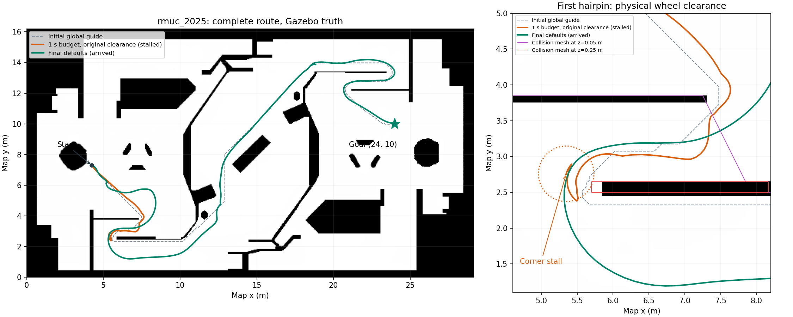

# rmuc_2025 长路径规划与弯角停滞修复

> 验收范围：下文仿真数据及 72 项测试结果采集于恢复 1 秒强制局部重规划之前。当前保留 0.5 s 规划预算和仿真 0.55 m 优化间距，现行重规划规则见[规划器说明](../../src/navigation/minco_planner/README.md#-状态机)。

在 `start_sim.sh` 默认的 rmuc_2025 / omni 场景实测复现，并对比 `navi_minco_bit` 原工程。当前工程基线为 `5fcc2f45`，原工程为 `8288b752`；对比时保留了两边已有的工作区修改。

## 根因与原工程对比

| 环节 | 原工程 | 当前工程的问题与处理 |
| --- | --- | --- |
| 全局 SMAC 搜索 | 使用代价地图快照和实时 ESDF 代价，没有整条流水线的 25 ms 截止时间 | 工作线程从派发开始，搜索、初值、MINCO、校验、偏航和采样共享 25 ms；复杂搜索尚未结束便抛出 `PlanningInterrupted`，随后从头重试。默认预算改为 500 ms。 |
| 地图来源 | PRIORMAP 的全局路径及稀疏检查使用 Nav2 地图，MINCO 和轨迹安全检查使用 ROG 查询 | 数据来源与原工程一致。真实地图及跨坐标系 ESDF 查询的开销明显大于原有合成地图基准。 |
| 局部路径提取 | 最近线段投影、缓存前进索引，按前视长度截取 | 当前使用最近路径点、沿路径截取。复现中的首要失败发生在全局搜索未完成时；最终配置已实测多弯路线，无需为此恢复整套进度缓存。 |
| 紫色 `localend` | 在 seed 构建后、轨迹优化及校验之前更新 | 当前更新时机相同。标记移动只说明尝试过局部规划，不能证明候选已通过校验并发布到 `/opt_path`。 |
| 优化避障间距 | 采用硬件参数配置 | 仿真沿用了优化间距 0.35 m，但 omni 轮组外接半径约 0.387 m，且该地图墙角与碰撞网格存在偏差。即使搜索恢复，转弯仍可能与实体墙角接触。仿真启动时将优化间距下限设为 0.55 m。 |

### 1. 25 ms 预算导致复杂搜索反复被丢弃

出生点约 `(4.234, 7.3)` 到 `(24, 10)` 的直线距离约 20 m，实际需要绕行多个发卡弯。原配置连续两次实测 8 s / 12 s 均没有新全局路径和可执行参考，机器人保持原地。临时诊断反复记录：

```text
interrupted stage=global elapsed=25.009 ms cancelled=false
interrupted stage=global elapsed=25.001 ms cancelled=false
```

只将工作线程预算放宽到 1 s，同场景搜索完成时间约 89–99 ms，立即开始行驶。复杂弯角的局部优化还观测到超过 200 ms 的耗时。25 ms 的旧校准来自常量距离查询和小型合成地图，未覆盖真实仿真查询负载。

最终默认采用有界的 0.5 s 预算，修改 C++ 默认值、参数声明及 `sentry1.yaml`。安全及控制回调仍各为 5 ms；版本取消、旧结果丢弃、碰撞校验继续生效。续接调度下限随预算变为 0.61 s，配置提前量仍为 0.8 s。

同时将真正耗尽规划预算的情况提升为限频警告，包含阶段和耗时；正常目标取消不产生此警告。

### 2. 优化避障距离不足，墙角接触后局部重规划反复失败

仅放宽预算，机器人在首个发卡弯约 `(5.35, 2.76)` 停滞；40 s 中产生了 37 条有效参考，但未到终点。同步 Gazebo 真值、TF、MPC 预测与实体 STL 截面发现，轮组进入墙角，而二维地图在该处还比实体凸缘向内约 0.15 m。短时开环指令亦出现受阻和明显偏转。

SDF 的四轮中心为 `(±0.22, ±0.22)`，球形碰撞半径为 0.076 m，因此全姿态包络半径为：

```text
sqrt(2) * 0.22 + 0.076 = 0.387 m
```

保持其他参数不变，仅将优化避障距离从 0.35 m 提至 0.55 m，便通过原停滞弯角，并在约 32 s 内到达 `(24, 10)`。

最终在 `sentry_simulation/launch/simulation.launch.py` 的仿真参数解析阶段，将 `minco_optimizer.safe_dist` 下限设置为 0.55 m，并保留用户已有的更大值。该距离覆盖约 0.387 m 的轮组包络及实测地图误差，作用于优化避障软代价；轨迹仍须通过独立碰撞校验。

这个参数覆盖只应用于当前支持的 omni 仿真模型。硬件参数文件中的避障间距、传感器配置、地图和 TF 未作修改；实车同样使用新的 0.5 s 规划工作线程预算，需要结合实机负载验证。本次未运行实车。

## 实测结果

最终验证使用 `start_sim.sh headless:=true rviz:=false` 的默认参数文件，没有额外传入调参 YAML。运行时参数服务确认规划预算 0.5 s、`safe_dist=0.55`、`collision_dist=0.2`、全局半径 0.2 m、ROG 距离场膨胀 0 m。

| 实验 | 结果 |
| --- | --- |
| 原 25 ms 预算，出生点 → `(24,10)` | 8 s / 12 s 两次均无可执行参考，基本零位移 |
| 仅放宽到 1 s，尺寸仍为原值 | 产生轨迹，但首个发卡弯停滞，40 s 未完成 |
| 1 s，仅将 `safe_dist` 改为 0.55 m | 约 32 s 完成，地图终点误差 1.46 cm |
| 最终默认配置，出生点 → `(24,10)` | 成功；约 42.8 s、真实行程约 45.9 m、20 条有效参考；地图终点误差 1.49 cm |
| 继续 `(24,10)` → 出生点 → `(24,10)` → 出生点 | 三个 action 均成功；停车后真值误差分别为 2.99 / 0.94 / 3.69 cm，底盘命令与真值速度均为零；检查脚本输出 `PASS accuracy` |

最终配置连续完成四段长路线，总真实行程约 177.2 m，覆盖反向穿过发卡弯及回到出生点后再次起步。长路线中仍有碰撞候选被正常拒绝并重试，随后生成有效轨迹；没有规划预算耗尽警告。测试判断依据是 Nav2 action 成功、同步真值/TF 和终点误差，而不是仅观察紫色端点或机器人开始移动。



图中橙色为只放宽预算后的 Gazebo 真实轨迹，绿色为最终默认配置真实轨迹，虚线为最终配置的初始全局引导。右图叠加实体 STL 的高度截面和停滞位置的轮组包络。

## 回归与复现

新增 `PlanningBudgetTest.ComplexGlobalSearchProducesExecutableReference`，通过真实异步工作线程、SMAC、局部优化和参考提交，注入 40 ms 地图快照延迟。修改预算前该用例在 40.6 ms 被中断，返回 false 且无参考；修改后约 49 ms 完成并提交可执行参考。当时同步更新了续接预算边界测试；恢复 1 秒强制重规划后，回归用例改为验证周期触发与异步结果轮询，复杂搜索用例继续保留。

```bash
source /opt/ros/jazzy/setup.bash
source install/setup.bash
CMAKE_BUILD_PARALLEL_LEVEL=2 colcon build --symlink-install \
    --packages-select minco_planner sentry_simulation --executor sequential
ROS_DOMAIN_ID=232 colcon test --packages-select minco_planner sentry_simulation \
    --event-handlers console_cohesion+
ROS_DOMAIN_ID=232 colcon test --event-handlers console_cohesion+
colcon test-result --verbose
```

构建成功；全工作区 18 包完成，汇总 72 tests、0 errors、0 failures、1 skipped（默认关闭的 MPC 基准）。结果扫描还报告已有 `build/sdformat_tools/package.xml` 断链，不影响上述测试结果。

仿真与探针需在相同 ROS domain 下运行；另一个终端启动探针。以下复用已有真值/停车精度检查脚本，单目标超时为 90 s，JSON 坐标使用浮点数：

```bash
ROS_DOMAIN_ID=231 GZ_PARTITION=minco_complex_route \
    NAV_INSTALL_DIR="$PWD/install" ./start_sim.sh headless:=true rviz:=false
```

```bash
source /opt/ros/jazzy/setup.bash
source install/setup.bash
ROS_DOMAIN_ID=231 python3 scripts/check_sim_goal_accuracy.py /tmp/complex_path_roundtrip \
    --goals '[[24.0,10.0],[4.234,7.3],[24.0,10.0],[4.234,7.3]]'
```

本次运行证据在临时目录 `/tmp/minco_complex_path_20261020/`，最终配置记录位于 `final_minimal/`：`simulation.log`、`runtime_params.json`、`loaded_plugins.json`、`long_goal/` 和 `roundtrip/`。仿真已关闭，临时诊断日志已从源码移除。仿真启动文件的修改位于 `src/nav-simulation` 子模块，由主仓子模块指针固定对应版本。
