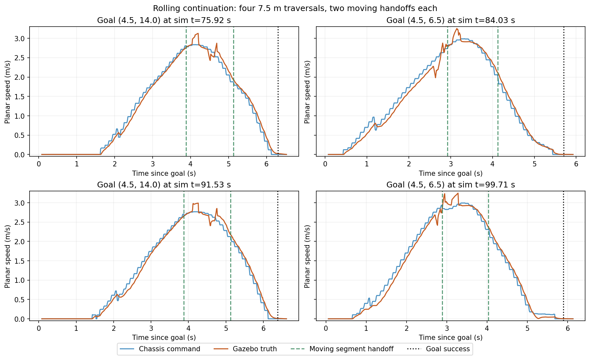

# 沿全局路径滚动续接与仿真验收

2026-10-20。目标：沿缓存的全局路径提前生成后续局部轨迹，中间段持续行驶，最终目标处停车。当前实现已通过 rmuc_2025 仿真中的四次 7.5 m 往返行驶及安全、目标更新回归。

一次目标对应多版 `/opt_path` 是局部滚动优化的正常输出。本次五个固定目标各只发布一次 `/plan`；局部段在旧段末尾之前更新，复用已有全局 guide。判断是否解决问题应同时看交接提前量、速度和全局路径更新次数。

## 原因与实现

| 原因 | 修改 |
| --- | --- |
| 旧续接提前量 0.2 s 小于 MPC 前视及调度时间，MPC 提前读到尾端的零速度保持参考 | 默认 `replan_lead_time_sec` 改为 0.8 s，覆盖当前约 0.55 s MPC 前视与延迟补偿、0.135 s 调度预算及余量 |
| 控制器按空间最近点跟踪，规划器只按轨迹时钟判断剩余时间 | 同时计算时钟剩余和最近采样点/相邻线段投影得到的空间剩余，任一达到阈值即续接 |
| 热启动按时钟继承速度，与控制器采用的空间进度不同 | 从空间进度继承速度、加速度及剩余轨迹初值，保留原有 5 ms 前推和偏差超限冷启动 |
| 距最终目标不足 1 m 的中间端点被强制设为零末速；到点容差也会误把截断点当成终点 | 仅全局 guide 的实际末点使用零末速，中间端点沿路径切线通过，速度受最大速度、曲率和 `sqrt(2*a_max*distance_to_goal)` 制动限制 |

空间投影遍历已缓存采样，最多 4096 点，无地图查询。工作线程读取采样时与已提交轨迹一并加锁。保活继续只更新外层发布时间，保留轨迹 ID、采样内容、采样点时间基准和 `start_WT`。FSM 的 `planningInProgress()` 领取异步结果逻辑保留。

主要文件：

- [minco_planner.cpp](../../src/navigation/minco_planner/src/minco_core/minco_planner.cpp)：续接触发、热启动进度和中间端点速度。
- [local_path_processor.cpp](../../src/navigation/minco_planner/src/minco_core/components/local_path_processor.cpp)：判定局部端点是否为全局终点。
- [sentry1.yaml](../../src/navigation/navi2_bringup/params/sentry1.yaml)：提前量及预算说明。修改 MPC horizon、dt 或补偿时间时应同步核对提前量。
- [check_sim_rolling_continuation.py](../../scripts/check_sim_rolling_continuation.py)：采集原始参考、保活、交接与真实速度。

## 回归验证

新增五项行为测试，实际运行 MINCO 局部优化及其真实边界状态：提前覆盖 MPC、机器人空间进度超前、中间端点非零末速、最终目标零末速、热启动继承空间进度速度。测试覆盖距目标不足 1 m 和不足旧 0.3 m 到点容差的中间截断点。

前三个缺陷用例在修复前失败；热启动测试另外测得修复前 0.125 m/s 的速度差。修复后 `test_planning_budget` 的 27 项全部通过。规划器、控制器的定向构建/测试通过，全工作区 18 包测试完成，结果汇总为 **71 tests、0 errors、0 failures、1 skipped**。跳过项是既有 MPC 性能基准测试。结果扫描仍提示既有 `build/sdformat_tools/package.xml` 缺失。

```bash
source /opt/ros/jazzy/setup.bash
source install/setup.bash
CMAKE_BUILD_PARALLEL_LEVEL=2 colcon build --symlink-install \
    --packages-select minco_planner minco_controller --executor sequential
ROS_DOMAIN_ID=217 colcon test --packages-select minco_planner minco_controller \
    --event-handlers console_cohesion+ --executor sequential
ROS_DOMAIN_ID=217 colcon test --event-handlers console_cohesion+ --executor sequential
colcon test-result --verbose
```

## 仿真结果

使用 Gazebo rmuc_2025、Point-LIO、GICP、Nav2、MINCO/MPC，独立 `ROS_DOMAIN_ID=227` 和 `GZ_PARTITION=minco_rolling_final`。实读续接参数为 0.8 s，`/clock` 发布者为 1。仿真沿用到点精度修复后的传感器、TF 和目标检查配置；临时 YAML 仅启用性能 CSV。

目标顺序为 `(4.5, 6.5) → (4.5, 14) → (4.5, 6.5) → (4.5, 14) → (4.5, 6.5)`。后四段各长 7.5 m，包含场地高差。

| 验收项 | 实测 |
| --- | --- |
| 全局路径复用 | 五个固定目标共五次 `/plan` |
| 正常中间滚动交接 | 四段行驶共八次，均未停车 |
| 提交时旧轨迹空间剩余时间下界 | 0.669～0.795 s，均大于当前 MPC 约 0.55 s 覆盖需求 |
| 同一交接位置的参考速度差 | 0.0054～0.0093 m/s |
| 交接前后各 0.25 s 最低底盘命令速度 | 1.401 m/s |
| 同窗口最低 Gazebo 真值速度 | 1.541 m/s |
| 参考保活 | 37 次，采样内容、ID、原始时间基准均保持一致 |
| 最终停车 | 五次 status=4；成功时真值平移速度不超过 0.0147 m/s，停稳后真值和底盘命令均为零 |

空间剩余时间使用 `(采样点数 - 2) × 0.05 - 投影进度` 作为保守下界，避免假设最后一段恰好长 50 ms。正常交接筛选要求旧末速 > 0.2 m/s、时钟跟踪偏差 < 0.45 m、距旧轨迹起点 > 0.5 m；全部交接记录仍保存在原始证据中。起步转向、偏差触发冷启动和最终停车单独可见。

速度连续性按**新轨迹首点位置投影到旧轨迹**后比较。机器人在工作线程取快照到 FSM 提交之间仍会移动；若把提交时机器人位置处的旧速度与快照处的新起点速度直接比较，会混入这段行驶差异。原始提交位置比较保留在 `commit_velocity_difference`，本轮最大 0.110 m/s；同位置比较最大 0.0093 m/s。两种数据及原始采样均保留，实际底盘与真值速度另行检查。



绿虚线为上述八次中间交接，黑点线为到点成功。末段向最终目标减速，交接处没有降至零再起步。图中起步阶段包含朝向调整和偏差修正。

| 次数 | 目标 | 成功时地图误差 | 成功时真值误差 | 停稳后真值误差 |
| --- | --- | ---: | ---: | ---: |
| 1 | (4.5, 6.5) | 0.0273 m | 0.0235 m | 0.0240 m |
| 2 | (4.5, 14) | 0.0286 m | 0.0296 m | 0.0306 m |
| 3 | (4.5, 6.5) | 0.0077 m | 0.0156 m | 0.0156 m |
| 4 | (4.5, 14) | 0.0307 m | 0.0332 m | 0.0336 m |
| 5 | (4.5, 6.5) | 0.0215 m | 0.0183 m | 0.0183 m |

同时间戳真值/TF 对齐后，以上记录的平面定位误差最大 0.0112 m；相对初始高度偏差变化最大 0.093 m，到点精度检查无违规项。

五目标窗口内，规划 CSV 共 55 条：32 次完成局部优化，23 次在进入优化器前拒绝局部 seed，集中在最终到点附近且 `optimizer_time_ms=NaN`。现有日志把 seed 无效也记为 `COLLISION`，结合该窗口的“路径过短/裁剪”日志辨识，不能将其理解为 23 次已优化轨迹碰撞。安全有效旧参考继续使用；此处仍存在末段短 seed 重试开销。

32 次成功局部优化的总耗时为 p50 **1.99 ms**、p95 **8.82 ms**、最大 **9.53 ms**（p95 使用最近秩）。这不包含全局搜索、排队和 FSM 提交，不能作为整条链路的硬实时上界。

## 事件与安全回归

在同一轮运行中继续检查：

- 固定目标观察 6 s，仅一次 `/plan`；发布目标更新后约 20.8 ms 收到新路径，恰新增一次 `/plan`，更新后的目标 status=4。
- 取消得到 status=5；同目标重新提交后恰新增一次 `/plan`，status=4。
- 同轨迹保活到原始年龄 2.15 s，超过控制器 2.0 s 参考超时，内容和进度基准保持一致。
- 插入 3.0 × 0.5 × 2.0 m 静态墙，经模拟激光和地图链路触发三次未过期参考撤销；撤销时剩余约 1.96～2.50 s。撤销至新参考期间分别记录 27、6、11 条命令，全部为零，间隔约 253、53、101 ms。
- 撤墙后导航至 `(4.5, 8.5)` 再返回 `(4.5, 6.5)`，均 status=4；成功时真值误差分别为 0.0041 m、0.0065 m，停稳真值和命令均为零。

墙体检查验证参考撤销分支，未将其算作完整绕障到达测试。停止仿真后已检查本轮 partition 无剩余进程。仿真结果覆盖上述路线；实车和更复杂弯道尚未验收。

## 证据与复跑

可直接查阅 [验收数值摘要](assets/20261020_rolling_continuation_summary.json) 和上方速度图。完整运行证据在本机 `/tmp/minco_rolling_20261020/`：

- `tests_red.log`、`hotstart_test_red.log`、`hotstart_test_green.log`、`focused_tests.log`、`workspace_tests.log`。
- `final/rolling/events.jsonl`：原始参考的 P/V/A/J、轨迹时间基准、运动命令和真值速度；`summary.json`：同位置速度比较后的汇总；`summary_submission_position_comparison.json`：原始提交位置比较汇总。
- `final/accuracy/`、`final/events/`、`final/obstacle/`、`final/recovery/` 及对应日志。
- `final/minco.csv`、`final/mpc.csv`、`final/simulation.log`、`final/parameters.txt`、`final/clock_publishers.txt`、`final/cleanup.json`。

```bash
# 终端 1：在独立仿真域启动当前工作区；CSV 参数可按已有临时 YAML 启用。
ROS_DOMAIN_ID=227 GZ_PARTITION=minco_rolling_final \
    NAV_INSTALL_DIR="$PWD/install" ./start_sim.sh headless:=true rviz:=false

# 终端 2：先记录交接，导航结束后 Ctrl-C 写出 summary.json。
ROS_DOMAIN_ID=227 python3 scripts/check_sim_rolling_continuation.py /tmp/rolling_check

# 终端 3：发送目标并核对到点误差与停车。
ROS_DOMAIN_ID=227 python3 scripts/check_sim_goal_accuracy.py /tmp/rolling_accuracy \
    --goals '[[4.5,6.5],[4.5,14],[4.5,6.5],[4.5,14],[4.5,6.5]]'

# 在工作区根目录复核本轮已保存证据并重绘图表（需 source 工作区）。
python3 /tmp/minco_rolling_20261020/summarize_final.py
```
