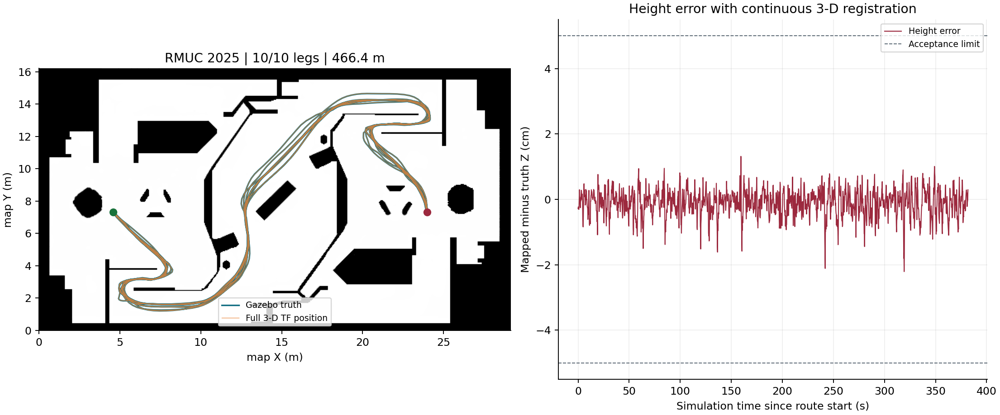

# RMUC 2025：新三维 TF 下的长路线与 STVL 修复

条件固定为 `world:=rmuc_2025 robot_model:=real folding_gimbal:=false`，Gazebo 无界面，Point-LIO + GICP + Nav2/MINCO 全链。每次先结束上一套 Gazebo 后才启动下一套。使用新 `rmuc_2025_mesh.pcd`，`publish_planar_tf: false`，Point-LIO 不广播原始 TF，统一 chassis_state 发布实体底盘状态。

## 已复现的根因

1. **地表语义缺失**：全局 STVL 把 0.1–0.8 m 内的坡面点直接标为障碍，膨胀后切断静态地图中可连通的通道。旧回放中 39 个点与 Gazebo 坡面高度相符，36 个落入阻断单元。清空代价地图不能修复；关闭全局 STVL 的对照恢复连通。
2. **局部里程计高度漂移**：初始地图修正后，0.5 m 体素在跨越不同高度地表时仍出现约 22 cm 的高度漂移。0.25 m 体素的无全局 STVL 对照完成 90.46 m 往返，高度最大误差 2.4 cm；但恢复全部障碍感知后换出的路线仍产生约 12 cm 偏差。因此没有把一次通过当作最终结论。平面拟合容差从 0.1 收紧至 0.03 后，仍曾超过 5 cm。
3. **全局定位仅初始化**：原仿真在初始 GICP 收敛后停止更新，局部漂移直接进入全局三维姿态。针对 RMUC 2025 开启现有持续地图配准。
4. **三维 TF 与二维检查不一致**：GICP 首次修正、收敛窗口和持续定位跳变原先都只检查 XY/yaw，纯 Z 或 roll/pitch 修正不会被这些门限检查。现在检查几何与 TF 发布模式一致：平面模式用 XY/yaw；三维模式用 XYZ 欧氏距离/SO(3) 角距离，保留原参数名以兼容。
5. **持续配准窗口固定在起点**：源云裁剪固定于 `camera_init` 原点，目标局部地图也以该原点变换选择，行驶到远处后丢失当前局部场景。现在源窗口按已有 LIO 平移移动，目标窗口随之移动，结果再严格变换回原始 `camera_init`。不改变对外 TF、里程计或指令坐标语义。

6. **固定 real 模型导航包络偏小**：第八段卡在 `(5.90, 2.99)`，距矮墙约 0.35 m。原静态 PGM 已包含该墙；运行代价为 89，规划可通行，原因是 Nav2 与 MINCO 只使用 0.321 m 半径而实体碰撞包络为 0.44 m。固定上部模型现在统一使用 0.44 m，保留 0.02 m padding；折叠配置沿用原接口。0.46 m 净距下起终点仍连通。真实 SDF 碰撞几何对运行配置的回归先失败（0.321 < 0.44），修复后通过。
7. **严重失跟后继续继承旧轨迹速度**：原 `HOT_START` 即使位置或速度偏差超过既有门限，仍从旧轨迹取速度与加速度。真实 ReplanLocal/optimizer 回归复现输出 0.5 / 3.0 m/s，而实测输入为 1.0 m/s。现在这两个分支选择已有 `COLD_START`，从实测状态重新优化，保留周期重规划节奏。新增两项测试与全部 54 项规划预算测试通过。

## 修改与回归边界

- 新地表先验由同一 Gazebo 网格生成：5 cm 栅格，保留从零高度地面连续可达的缓坡表面；孤立箱顶不作为地面。保留同一 XY 上多个地表层。
- `terrain_obstacle_filter` 在观测时间使用完整三维 TF 转入 map，只移除已知地表附近 5.5 cm 的点。未知区域及高于地表的点保留。两个 STVL 都保持开启，以 `body` 为清除传感器原点。
- 地表先验仅接入 RMUC 2025。它依赖匹配的地图，并不是其他赛场的在线地面建图器。5.5 cm 容差内的物体无法靠此过滤器与地面区分。
- Point-LIO 使用 0.25 m 体素与 0.03 m 平面容差。0.1 m 体素曾产生严重实时积压，因此没有采用。
- 长路线脚本新增同步高度误差统计/断言，防止只凭 XY/yaw 或到达状态掩盖三维失败。
- GICP 回归包含纯高度/倾斜修正、任意世界航向下的旋转距离、20 m 外真实裁剪/配准和返回坐标系。先确认失败，再修复。

## 最终运行结果

上一轮 `.scratch/stvl-moving-window` 完成 7/10 段，第八段发生实体碰墙停滞；全程记录高度误差最大 0.035314 m，完整姿态误差最大约 0.5901°。该轮判定失败。它证明移动 GICP 窗口解决了此前严重定位漂移，但不能作为整体验收通过。

`.scratch/stvl-envelope-coldstart` 在全部修复与新三维 TF 条件下完成 **5 个往返，10/10 段通过**，累计 466.4498 m，路线测试耗时 387.64 s（墙钟）。验收限值：高度 0.05 m，XY 定位 0.12 m，到点 0.15 m。

| 指标 | 实测 |
|---|---:|
| 同步 XY 定位最大误差 / P95 | 0.01408 / 0.00911 m |
| 同步高度最大误差 | 0.02395 m |
| 完整姿态 SO(3) 最大误差 / P95 | 0.4271° / 0.2163° |
| 各段稳定后到点最大误差 | 0.04669 m |
| 真值位置到 MPC 参考折线距离 P95 / 最大 | 0.06801 / 0.10582 m |
| 跟踪距离样本 | 1441（运动中且有新鲜有效参考） |
| 完整三维位姿样本 | 1903 |
| 底盘三维变换组合最大矩阵元素残差 | 3.55e-15 |
| ROS ERROR | 0 |
| 仿真进程树峰值 RSS / 最低可用内存 | 5.25 / 3.97 GiB |

不同采样器频率不同，高度验收使用 3634 个同步样本中的较大值 0.02395 m；图中使用完整四元数采样器的 1903 个样本。参考折线距离是几何跟踪指标，不是按期望时间索引计算的纵向延迟误差。

启动及结束的原生 C++ DDS writer 采样均显示 10 条关键 TF 边各有且仅有一个发布者。运行参数确认新 PCD、publish_planar_tf=false、持续配准、固定关节、Point-LIO 原始 TF 关闭、两个 STVL 开启以及 MINCO 半径 0.44 m。未把真值作为导航定位输入。

运行中有 16 个候选轨迹被已有验证拒绝（碰撞 8 次、动力学 8 次），3 次 yaw 优化回退，1 次大位置偏差；规划随后继续运行，全部目标成功。保留这些诊断，不能将“10/10 到达”解读为零优化回退。



## 实体障碍检查与仍然存在的机械遮挡

同一 Gazebo、同一新三维 TF 下，机器人停在约 (4.58, 7.34) 后加入 0.4 × 0.4 m 静态箱体，测试后移除：

| 位置 / 高度 | 结果 |
|---|---|
| (5.8, 7.3) / 0.24 m | 障碍点保留，代价 0 → 99；移除后恢复 0 |
| (4.6, 6.1) / 0.18 m | 障碍点保留，代价 0 → 99；移除后恢复 0 |
| (5.8, 7.3) / 0.18 m | 原始 GPU 激光、完整注册点云和障碍点云均无箱体回波，未标记 |
| (5.8, 7.3) / 0.50 m（只改变高度） | 原始点云与注册点云可见上部，原始点云最低可见高度约 0.193 m |

对同一固定 CAD 模型作线段—三角面求交，从实际雷达中心到正前方 0.18 m 箱顶的射线分别在约 0.114 m 和 0.194 m 处被 yaw_link4 与 small_pitch 遮挡；同点 0.24 m 箱顶射线无交点。侧方 0.18 m 箱顶射线也无交点，并已实测可标记。这排除了“地表过滤器误删所有低障碍”和“新插入实体不参与激光渲染”两个假设。

**因此当前不能宣称所有障碍检测问题已解决。** 已修复的地图、三维定位、STVL 地表误标、导航包络和重规划问题在该长路线通过；固定真实模型仍存在特定方向的低位机械视线盲区。保持真实碰撞/视觉几何和当前安装关系时，修改 TF 或过滤阈值不能恢复被遮挡的回波。本次未删除遮挡部件、伪造点云或引入真值障碍输入。后续需要确认真实雷达光心/安装标定与机构遮挡，必要时调整安装或补充传感器；属于 #11 实机验证范围。

## 复现与留档

运行条件、文件摘要、逐段结果、误差统计、障碍检查和射线证据存于 artifacts/2026-11-27-terrain-continuous/。完整原始运行日志与捕获存于 .scratch/stvl-envelope-coldstart/，上一轮失败日志保留在 .scratch/stvl-moving-window/。工作区原有无关修改未纳入本轮提交。归档的运行参数路径以 ${WORKSPACE} 表示工作区根目录。

```bash
source /opt/ros/jazzy/setup.bash
source install-link/setup.bash
export ROS_DOMAIN_ID=182 ROS_AUTOMATIC_DISCOVERY_RANGE=LOCALHOST
export GZ_PARTITION=yaw_runtime_acceptance OMP_NUM_THREADS=2
ros2 launch sentry_simulation simulation.launch.py world:=rmuc_2025 robot_model:=real folding_gimbal:=false chassis_type:=omni headless:=true headless_rendering:=true rviz:=false
# 同一 ROS 域的另一终端，只启动验收客户端，不再启动 Gazebo：
python3 scripts/check_sim_navigation_loop.py <output-directory> --cycles 5 --goal-timeout 150 --max-height-error .05 --goals '[[24.0,7.3],[4.6,7.3]]'
```

主仿真已停止后串行执行包测试，避免重叠 Gazebo 实例。MINCO 67 项、GICP 5 项及 sentry_simulation 16 个 CTest（test-result 汇总 22 项）全部通过，0 失败、0 跳过。主仿真与测试启动的物理仿真均已退出。
