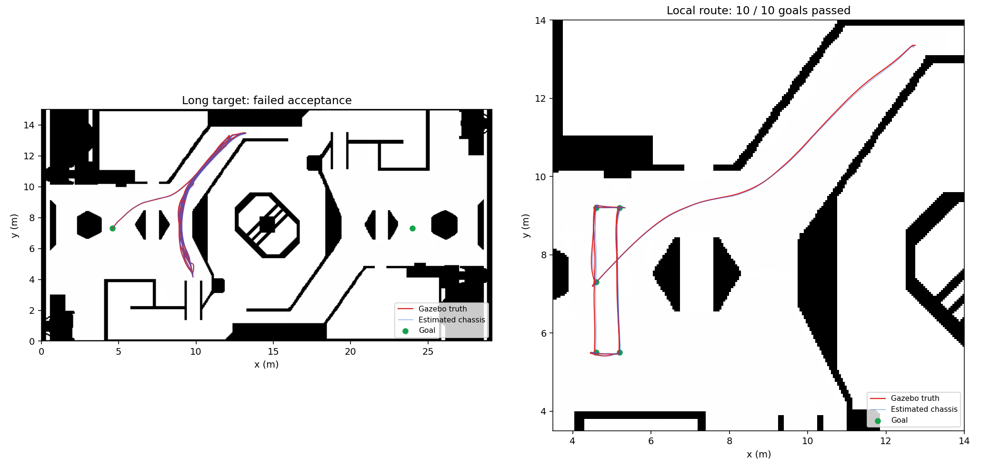
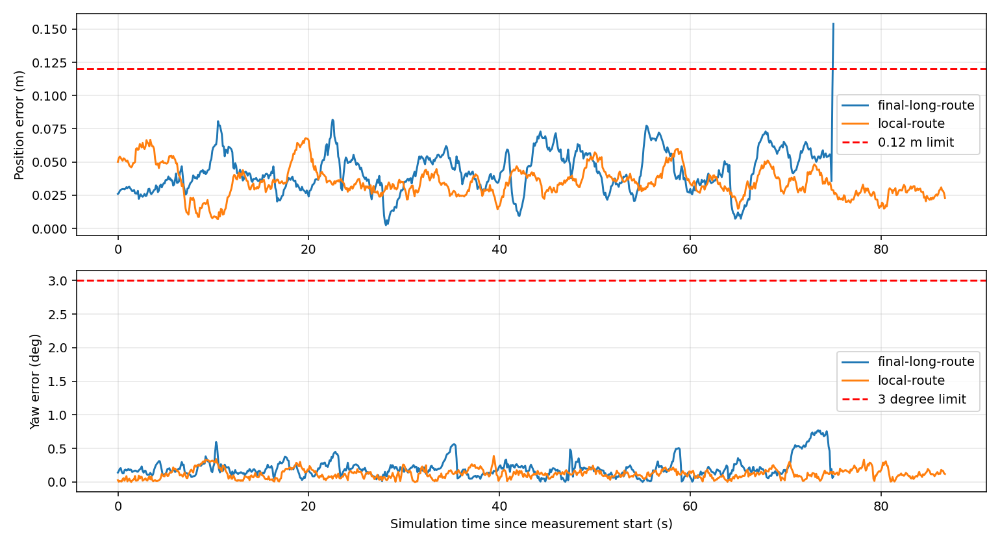

# Gazebo + Point-LIO + Nav2 运行验收

日期：2026-11-27。结论：**局部路线通过，长距离穿场路线不通过；整套运行验收不通过。**

本次实际运行 Gazebo Harmonic、CAD `real` 模型、omni 底盘、Point-LIO、
GICP、chassis_state、MINCO/MPC 和 Nav2。世界为 `rmuc_2026`。
测量取 Gazebo 真值与相同时间戳的 TF，导航目标经 `/navigate_to_pose` 下发。
这补充此前的[合成软件验收](yaw-chassis-software.md)，不替代 #11 实机标定。

## 单会话和资源

全程只保留一套整链仿真；修复后重启前确认上一会话所有已记录子进程退出。
所有整链运行均无 GUI、无 RViz，使用独立 ROS domain 182 和 Gazebo partition。
监督进程持有文件锁，保存 PID/进程组，只停止自身会话；运行结束已关闭整链仿真。
回归中的微型物理测试在整链退出后串行执行。

```bash
source /opt/ros/jazzy/setup.bash
source install-link/setup.bash
export ROS_DOMAIN_ID=182 ROS_AUTOMATIC_DISCOVERY_RANGE=LOCALHOST
export GZ_PARTITION=yaw_runtime_acceptance OMP_NUM_THREADS=2
ros2 launch sentry_simulation simulation.launch.py \
  world:=rmuc_2026 robot_model:=real chassis_type:=omni \
  headless:=true headless_rendering:=true rviz:=false log_level:=warn
```

三次整链启动均为顺序执行。进程组 RSS 峰值分别 3.77 / 3.92 / 3.82 GiB，
系统最小可用内存分别 2.36 / 2.33 / 5.92 GiB。没有触发内存停止阈值。
最终修复后的会话约 378 秒墙钟时间。

## 实测发现与已修复项

1. **启动地图航向遗漏大 Yaw 正常姿态角。** 静止 XY 误差只有约 5 mm，
   但 `map → base_link` 航向误差为 -44.90°，GICP 超时回退。
   初始化现在同时旋转雷达偏移和姿态，使用正常启动关节角 π/4。
   修复后 GICP 连续三个独立窗口确认匹配；一次静止复测 XY 误差 7.1 mm、
   航向误差 0.22°。补充了初始化位姿几何回归。
2. **Featherstone 非根连杆速度缓存为零。** 原地旋转时真值约 0.4 rad/s，
   移动 IMU 姿态变化，但其角速度为 0；LIO 不能跟随并快速发散。
   本包物理后端改为从实际关节状态计算连杆速度，旋转到世界并补偿质心到连杆原点。
   新的真实关节物理测试先失败、修复后通过，覆盖角速度、切向和向心加速度。
   原自由落体/根连杆 IMU 测试仍通过。
3. **GICP TF 丢弃高度、roll、pitch。** 新增 `publish_planar_tf` 参数，保留原默认
   `true`；仅仿真配置为 `false`，使用完整配准变换。补充保留高度/重力方向的测试。
   没有改变实机 GICP 默认行为。
4. 验收脚本加入逐样本 XY/航向阈值，防止静止或到点快照掩盖途中偏差。
   被动 TF 审计记录完整姿态、消息延迟、父节点冲突及发布者标识可用性。

修复提交：主仓库 `7c9c9561`（及后续审查修正），仿真子模块 `3d7d9d6`。

## 路线结果

| 项目 | 局部多段路线 | 长距离穿场单目标 |
| --- | --- | --- |
| 目标 | `(4.6,7.3) → (4.6,9.2) → (5.2,9.2) → (5.2,5.5) → (4.6,5.5)`，2 轮 | `(24,7.3) → (4.6,7.3)`，计划 5 轮 |
| 完成 | **10/10**，全部 action status 4 | **0/10**，首段途中失败并取消 |
| 真值累计里程 | 27.33 m（包含从前次停止位置返回首目标） | 105.26 m |
| 墙钟时间 | 94.64 s | 82.85 s，阈值失败时结束 |
| 最大到点误差 | 0.0749 m | 未到点 |
| 运动中最大 XY 定位误差 | 0.0680 m | 0.1540 m，超过 0.12 m |
| XY 定位误差 P95 | 0.0564 m | 0.0681 m |
| 最大航向误差 | 0.389° | 0.770° |
| 轨迹碰撞候选拒绝 / 动力学候选拒绝 | 0 / 0 | 2 / 10 |
| Yaw 优化回退日志 | 3 | 11 |
| ROS ERROR | 0 | 见原始事件/日志；按定位阈值终止 |

到点判定限为 0.30 m；局部实测也满足 0.15 m。运动定位限为 0.12 m、航向 3°。
候选轨迹拒绝日志不等于发生实体碰撞。本次没有接触传感器统计，因此不把碰撞次数宣称为零。





长目标在中央障碍西侧反复折返，未穿场。路线取消后的被动观察中，XY 误差一度达
0.587 m，三维位置误差达 0.596 m；完整姿态误差最大 1.515°。
这说明修复 IMU 零速度后，长目标的规划/跟踪及局部配准稳定性仍有未解决问题。
本次证据不能独立断定是全局路径、候选切换、环境可观测性还是其他控制问题导致；
后续应以该路线的路径、候选状态、指令和点云日志缩小复现，不能把它归为单纯 TF 成功。

## TF、频率与最终状态

被动审计覆盖约 248 秒仿真时间，1362 个同步姿态样本，持续阶段 TF 查询失败 0。
完整关键链为 `map → pcd_map → camera_init → base_link → lidar_yaw_mount → body`；
`base_link_fake` 从 base_link 派生，vision_gimbal 从 lidar_yaw_mount 派生。
收尾 20 秒独立采样未发现多父节点；启动收集 TF 缓存期间 3 次查询暂不可用。

同一段累计接收 IMU 248537 条、真值 24854 条、关节反馈 24814 条、
原始 LIO odom 19567 条、底盘 odom 18911 条、点云 2484 条。
这些是观察者接收率，约对应 1002 / 100 / 100 / 79 / 76 / 10 Hz，含 DDS 发现期，
不应当作逐节点内部定时器频率。底盘消息测量时间最大滞后约 0.171 秒。

Jazzy rclpy 的消息 info 不提供 writer GID，审计明确标记
`publisher_identity_available=false`，不能仅凭 `duplicate_edges=[]` 宣称唯一发布者。
结合端点列表、启动配置和代码核查：Point-LIO 虽创建 `/tf` 端点，但运行参数
`publish.tf_send_en=false`；底盘链由 chassis_state 发布，地图修正由 GICP 发布，
仿真附属雷达/云台 TF 由 gimbal 节点发布。未发现竞争父节点或关键链断开。

`vision_gimbal` 仍是本阶段小云台的固定近似；本次没有独立驱动小云台，也没有相机光学
外参真值，不能据此验收相机光学标定。此次路线测试也不能替代大 Yaw 独立扫转的全部实机工况。

## 回归与证据

```bash
colcon test --build-base build-link --executor sequential \
  --event-handlers console_cohesion+
colcon test-result --test-result-base build-link --verbose
```

整链关闭后串行执行：**173 tests, 0 errors, 0 failures, 1 skipped**。
新增物理关节测试和 GICP 三维 TF 测试通过；审查发现的单独 accuracy 入口未启用
逐样本限值、TF 审计未报告多父节点两处问题已修正。规范审查无硬性违规。

摘要：
[局部路线](artifacts/2026-11-27-runtime/local-route.json)、
[长目标](artifacts/2026-11-27-runtime/final-long-route.json)、
[持续 TF](artifacts/2026-11-27-runtime/final-tf.json)、
[收尾 TF](artifacts/2026-11-27-runtime/final-tf-check.json)。
完整本机日志、采样、失败前后物理测试、资源记录保存在
`.scratch/yaw-runtime-acceptance/`（未提交的运行产物），原始目录为
`/tmp/yaw-runtime-acceptance/`。仿真会话已退出，未推送提交、未关闭工单。
