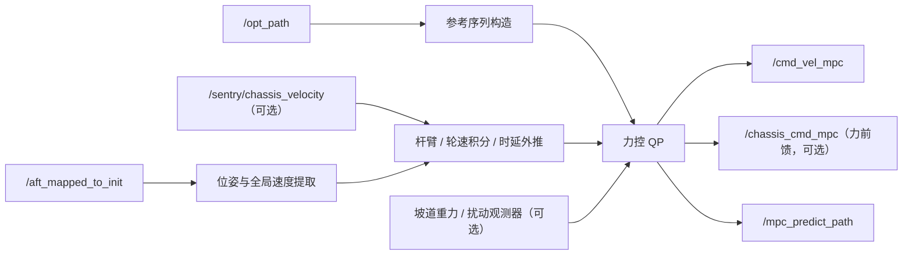

# 🎮 MincoMpcController

> 面向全向哨兵底盘的 Nav2 Controller 插件：以 MINCO 轨迹为参考，用力控（动力学）MPC 规划驱动力，输出全局坐标系速度指令，可选同时下发力前馈。

[返回项目主页](../../../README.md) · [MINCO Planner](../minco_planner/README.md)

## ✨ 模块定位

`minco_controller::MincoMpcController` 实现 `nav2_core::Controller`，订阅规划器生成的 `/opt_path` 与 Point-LIO 里程计，在 Nav2 Controller Server 的控制周期内求解 `DynamicMpcSolver`。当前主配置控制频率为 **100 Hz**。原先的速度层 SE(2) 运动学 MPC 已删除。

主要特性：

- 状态 `[px, py, yaw, vx, vy, omega]`，输入 `[Fx/m, Fy/m, Mz/Iz]`，零阶保持精确离散的双积分模型。
- 平移 QP（2N 维）与 yaw QP（N 维）分开用 qpOASES 热启动求解；N=40 时 p50 约 0.4 ms。
- 平移合力受摩擦圆 `min(mu·m·g, max_force)` 内接八边形约束，`|Mz| ≤ max_torque`，速度作为状态约束；初速越界时自动放宽保持可行。
- 单调推进参考索引，控制时延、雷达到底盘参考点杆臂补偿。
- 可选：坡道扰动与扰动观测器、轮速融合、力前馈（均默认关闭）。
- 支持固定角速度小陀螺模式，发布预测轨迹，提供求解耗时与频率统计。

## 🧠 模块流程图



### 流程概述

控制器以 `/opt_path` 中的 P/V/A/J 与 yaw 参考构造 `dynamic.lookahead_time` 时域、`dynamic.dt` 步长的参考序列，同时从 latest-state odom 提取当前状态。时延 `control_delay_compensation` 内用上一次已下发的加速度外推（启用轮速融合时，从 LIO 时间戳到当前时刻改用轮速积分）。QP 的输入以 MINCO 参考加速度为前馈 `m·(a_ref − d)`，位置/速度误差按参考速度切向分为沿轨迹与横向权重。求解后取预测轨迹 `t0 + command_lookahead` 处的速度，经 speed limit 与速度死区后从 `/cmd_vel_mpc` 输出世界坐标系速度。

`command_lookahead` 应接近底盘速度环的等效时间常数，过短会导致到点超调（仿真底盘约 0.2 s，实车需重新测定）。

输入新鲜度同时检查 ROS 消息时间戳和现实接收间隔，两者均使用
`reference_timeout_sec`（默认 2 s）和 `odom_timeout_sec`（默认 0.3 s）。
任一检查过期即停止输出；即使 ROS 仿真时间暂停，现实接收超时仍生效。

## 🏋️ 可选功能

参数均位于 `FollowPath.dynamic.*`，默认关闭：

- **坡道扰动 `d`**：模型变为 `v' = a + d`，前馈 `m·(a_ref − d)`，输出速度额外提前 `command_lookahead·(−d)`。`d` 可来自 `slope_gravity`（odom 姿态求坡面切向重力，`gravity_body_roll_offset` 去掉 body 安装横滚）和 `disturbance_observer`（一阶滞后加集总扰动的 Luenberger 观测器，见 `disturbance.hpp`）。每轴按 `maxDisturbance()` 截断。
- **轮速融合 `wheel_odometry`**：订阅底盘系 `TwistStamped`（默认 `/sentry/chassis_velocity`），从 LIO 时间戳积分到当前时刻；航向用 LIO yaw（`base_link_fake` 抵消了 yaw）。缺失、中断或陈旧时退回 LIO，并节流告警。
- **力前馈 `force_ff`**：额外发布 `/chassis_cmd_mpc`（`ros_interfaces/msg/ChassisCommand`，sensor-data QoS），同一控制周期的速度与 `F_ff = gain·m·a_plan(t0 + force_ff.lookahead)`，与 `/cmd_vel_mpc` 同一坐标系，按 `force_ff.max_force` 限幅。速度提前量随 `gain` 从 `command_lookahead` 线性缩到 `force_ff.lookahead`，避免底盘速度 PID 与前馈重复提供同一加速度。速度被死区清零或任何原因被抑制时，前馈同时清零。`ros2_libxr` 在其新鲜时优先转发它，否则退回 `/cmd_vel_mpc` 且不带力。yaw 力矩默认关闭。
- 详细 CSV 含 `dist_x/dist_y`。

`./start_sim.sh` 用仿真底盘质量生成参数副本；`SIM_WHEEL_ODOM=1`、`SIM_SLOPE_COMP=1`、`SIM_FORCE_FF=<gain>` 分别打开上述功能。物理参数需实车标定，仿真结果与限制见 `docs/ai_refactor_records/20261022_force_control_mpc.md` 及后续记录。

## ⚡ 性能方向

- 平移与 yaw 分开求解，缓存预测矩阵与约束，持久保存 qpOASES `SQProblem` 热启动；失败后重置并尝试一次冷启动。
- odom 订阅使用 `KeepLast(1) + best_effort + volatile`，只消费最新状态，避免高频定位消息排队。
- `/opt_path` 使用 `SystemDefaultsQoS`；控制与预测可视化 publisher 深度为 1，避免历史控制结果积压。
- `MpcPerformanceMonitor` 在开关启用时记录求解耗时、完整周期耗时、控制频率、命令/参考速度和 odom 回调延迟；关闭时不写 CSV。

求解器回归测试与可选微基准：

```bash
source /opt/ros/jazzy/setup.bash
colcon build --symlink-install --packages-select minco_controller --cmake-args -DBUILD_TESTING=ON
colcon test --packages-select minco_controller --event-handlers console_cohesion+
colcon test-result --test-result-base build/minco_controller --verbose
# 与独立稠密 QP 对比，输出 p50/p95/p99 微秒耗时。
build/minco_controller/dynamic_mpc_solver_test --gtest_filter='*Benchmark' --gtest_also_run_disabled_tests
```

## 🌐 坐标系与输出约定

控制器从 odom 四元数提取 yaw，将雷达参考点速度转换并补偿到底盘控制参考点。输出的 `vx/vy` 保持为**全局坐标系速度分量**，用于当前下位机通信约定；不要默认把它当作 `base_link` 局部速度。

杆臂速度关系可概括为：

```text
v_base = v_lidar + ω × r
```

其中 `r` 的符号取决于配置中“雷达参考点相对底盘参考点”的定义。修改安装位置后，Planner 与 Controller 必须同步校核。

## 📡 ROS 接口

| 方向 | Topic | 类型 | 说明 |
|---|---|---|---|
| 输入 | `/opt_path` | `ros_interfaces/msg/MpcPositionCommand` | MINCO 位置、速度、朝向参考 |
| 输入 | `/aft_mapped_to_init` | `nav_msgs/msg/Odometry` | 当前位姿、速度与角速度 |
| 输入 | `/sentry/chassis_velocity` | `geometry_msgs/msg/TwistStamped` | 底盘系轮速（`dynamic.wheel_odometry` 开启时） |
| 输出 | `/cmd_vel_mpc` | `geometry_msgs/msg/Twist` | 提供给 `ros2_libxr` / 底盘链路的速度命令 |
| 输出 | `/chassis_cmd_mpc` | `ros_interfaces/msg/ChassisCommand` | 速度 + 力前馈（`dynamic.force_ff.enable` 开启时） |
| 输出 | `/mpc_predict_path` | `nav_msgs/msg/Path` | MPC 预测轨迹可视化 |

Nav2 标准接口 `setPlan()`、`computeVelocityCommands()` 和 `setSpeedLimit()` 仍由插件实现；项目主链路的高阶轨迹信息来自 `/opt_path`。

## ⚙️ 关键参数

配置位于 `src/navigation/navi2_bringup/params/sentry1.yaml` 的 `controller_server.ros__parameters.FollowPath`。

| 参数 | 当前典型值 | 说明 |
|---|---:|---|
| `controller_frequency` | `100.0` | Controller Server 调用频率 |
| `control_delay_compensation` | `0.05` | odom 时间戳到命令生效的时延外推 |
| `vx/vy_min/max` | `±3.0` | 全局平移速度状态约束 |
| `omega_min/max` | `±5.0` | 角速度状态约束 |
| `deadzone_speed_threshold` | `0.1` | 参考全程静止且命令低于该值时输出零 |
| `dynamic.dt` / `dynamic.lookahead_time` | `0.02` / `0.8` | 预测步长与时域（N = 40） |
| `dynamic.command_lookahead` | `0.2` | 输出速度在预测轨迹上的取样时刻 |
| `dynamic.mass` / `inertia_z` | `25.0` / `1.0` | 占位值，需实车标定 |
| `dynamic.friction_coeff` / `max_force` / `max_torque` | `0.6` / `60` / `5` | 驱动力约束，占位值 |
| `dynamic.q_*` / `r_*` | 见 yaml | 沿轨迹/横向跟踪权重，输入偏差与差分权重 |
| `use_small_gyro_mode` | `false` | 固定角速度小陀螺模式 |
| `fixed_wz` | `4.18` | 小陀螺目标角速度 |

### 📐 杆臂与姿态补偿

```yaml
lidar_offset_x: 0.0
lidar_offset_y: -0.20
lidar_roll_offset: 0.1745
```

- `lidar_offset_x/y`：里程计参考点与底盘控制参考点的平面偏移。
- `lidar_roll_offset`：安装姿态导致的固定横滚补偿。
- 三者均是实体标定量，不应仅凭轨迹观感随意调整。
- 修改后应低速验证原地旋转、纯 x/y 平移和组合运动，确认补偿方向正确。

## 🚀 启动与检查

控制器随 Nav2 完整启动：

```bash
ros2 launch navi2 navigation2.launch.py
```

运行时检查：

```bash
ros2 topic hz /opt_path
ros2 topic hz /aft_mapped_to_init
ros2 topic hz /cmd_vel_mpc
ros2 topic echo /cmd_vel_mpc --once
```

在 RViz 中叠加 `/opt_path_vis` 与 `/mpc_predict_path`，可快速判断误差来自参考轨迹还是控制器预测。

## 📈 性能观测

`performance.enable` 为总开关，`print_enable`、`detailed_csv_enable` 和 `odom_sub_debug_enable` 分别控制终端摘要、逐周期 CSV 和 odom 订阅窗口统计。当前比赛 YAML 中总开关与 `print_enable` 为开启，详细 CSV 与 odom 窗口统计关闭；由于周期样本只在 detailed CSV 开启时采集，默认不会记录逐周期求解 CSV。详细性能 CSV 默认路径：

```text
/tmp/mpc_perf_detailed.csv
```

字段包含 `success`、`solve_time_ms`、`cycle_time_ms`、`controller_hz`、`cmd_vx/vy/wz` 和 `ref_vx/vy/wz`，并可附带 `run_id/scenario/variant`。`csv_flush_every_n` 用于降低刷盘频率。

重点关注控制回调实际频率、QP 求解 P95/P99、失败次数，以及命令速度与参考速度的稳态差。100 Hz 控制要求 CSV、终端日志和可视化不能阻塞主回调。

## 输入失效保护

`FollowPath.reference_timeout_sec` 默认为 2.0 s，`FollowPath.odom_timeout_sec` 默认为 0.3 s。控制器同时检查消息时间戳和 `steady_clock` 接收间隔；任一输入缺失、过期或时间戳位于未来时，返回并发布全零速度，包括小陀螺角速度。即使 ROS 仿真时间暂停，接收超时仍生效。

输入过期只会零速等待，不会让 FollowPath 失败。规划器放弃当前目标时，在 `/opt_path` 发布 `PLANNING_FAILED_COMMAND`。控制器锁存该通知，发布零速后抛 `nav2_core::NoValidControl`，controller_server 据此中止 FollowPath，交给行为树恢复。锁存只在新一次 FollowPath 执行（`reset()` 加 `setPlan()`）时清除。

取消、重启和参考替换递增控制端版本。每次计算在输出前重新检查版本和输入时效，期间发生取消/重启的计算结果会被置零。该检查在 Nav2 调用 `computeVelocityCommands()` 时执行，其响应间隔取决于 controller_server 的控制周期。

## ⚠️ 已知问题与改进方向

- 当前电控速度跟随存在稳态误差，上游 Planner 因而强制保留热启动速度/加速度前馈。该补偿会提高参考速度，但不能替代底盘速度闭环标定；应联合对比 `ref_v*`、`cmd_v*` 与底盘反馈。
- 模型是质点双积分加一阶执行滞后（由 `command_lookahead` 近似），未描述轮胎侧滑与执行延迟变化；`mass`、`max_force` 等物理参数目前是占位值，实车启用前需标定，并实测底盘速度环时间常数来设定 `command_lookahead`。
- `/opt_path` 与 odom 使用不同 QoS 语义：轨迹为系统默认 QoS，odom 为 best-effort latest-state。诊断“无控制输出”时必须分别检查两条订阅是否匹配。
- 预测轨迹用于诊断，不代表底盘真实执行路径；实际闭环效果需结合 odom、视觉侧通信诊断和下位机反馈判断。

## 🛠️ 常见问题

| 现象 | 优先检查 |
|---|---|
| `/cmd_vel_mpc` 无输出 | Nav2 lifecycle、是否收到 `/opt_path` 与 odom |
| 速度方向与车体直觉不一致 | 输出为全局速度；核对下位机坐标约定 |
| 原地旋转伴随平移 | 杆臂偏移符号、雷达安装位置和角速度单位 |
| 高频振荡 | `dynamic.q_*`/`r_*` 比例、时延补偿、参考密度、力前馈增益 |
| 跟踪明显滞后或到点超调 | odom/轨迹时间戳、`command_lookahead`、`max_force/mass` 与下位机延迟 |
| QP 不可行 | 初始状态偏差、速度边界、驱动力上限和参考突变 |
| 小陀螺退出异常 | 上层模式切换是否恢复参数与固定角速度配置 |

## 🗂️ 关键源码

- `src/minco_mpc_controller.cpp`：插件生命周期、参考构造、补偿、力前馈与输出。
- `src/dynamic_mpc_solver.cpp`：力控 QP；`src/disturbance.cpp`、`src/wheel_odometry.cpp`：扰动观测与轮速积分。
- `include/minco_controller/minco_mpc_controller.hpp`：状态、参数与接口定义。
- `minco_controller.xml`：pluginlib 注册信息。
- `src/navigation/navi2_bringup/params/sentry1.yaml`：比赛主参数。

## 📚 延伸阅读

轨迹如何生成见 [MincoPlanner 文档](../minco_planner/README.md)，系统启动和通信链路见[项目主 README](../../../README.md)。
